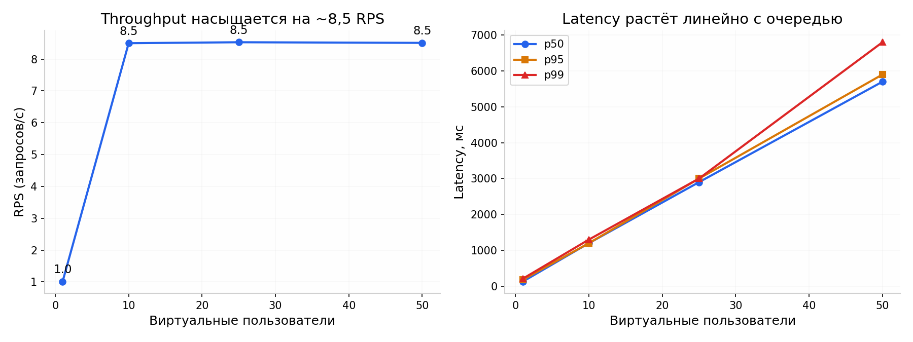

# Отчёт о нагрузочном тестировании — ДЗ1 (MLOps)

**Сервис:** FastAPI + ONNX Runtime, модель MobileNetV2 (классификация ImageNet), API по спецификации Open Inference Protocol v2.
**Образ:** `ghcr.io/uritskii/mlops-hw1:latest`

## Условия тестирования

- Контейнер запущен с лимитами проверяющего стенда: `docker run --cpus=4 --memory=16g`
- Генератор нагрузки: locust 2.47 (headless), каждый виртуальный пользователь шлёт ~1 RPS
- Запрос: `POST /v2/models/mobilenetv2/infer`, входной тензор FP32 `[1,3,224,224]` (плоский массив, ~600 КБ JSON)
- Длительность каждого прогона: 60 с
- Конфигурация сервиса: 1 процесс uvicorn (workers=1), семафор на 4 одновременных инференса

## Результаты

| Пользователи | Запросов | RPS | Среднее | p50 | p95 | p99 | Max | Ошибки |
|---|---|---|---|---|---|---|---|---|
| 1  | 60  | 1,01 | 138 мс  | 130 мс  | 180 мс  | 210 мс  | 213 мс  | 0% |
| 10 | 500 | 8,50 | 1143 мс | 1200 мс | 1200 мс | 1300 мс | 1296 мс | 0% |
| 25 | 503 | 8,53 | 2726 мс | 2900 мс | 3000 мс | 3000 мс | 3659 мс | 0% |
| 50 | 501 | 8,51 | 5242 мс | 5700 мс | 5900 мс | 6800 мс | 6996 мс | 0% |



## Выводы

1. **Одиночный запрос — ~130–140 мс end-to-end** (приём ~600 КБ JSON, валидация, инференс MobileNetV2 на CPU, сериализация 1000 выходов).
2. **Throughput насыщается на ~8,5 RPS** уже при 10 пользователях и дальше не растёт — сервис упирается в CPU: инференс — синхронная CPU-bound операция, а `async def`-обработчик блокирует event loop, поэтому запросы фактически обрабатываются последовательно (~115 мс на инференс ≈ 8,5 RPS).
3. **За пределами насыщения растёт только очередь:** latency растёт линейно с числом пользователей (1,1 с → 2,7 с → 5,2 с), при этом p99 не отрывается катастрофически от p50 — очередь равномерная.
4. **Деградация управляемая:** 0 ошибок и 0 потерянных соединений на всех уровнях нагрузки, процесс остаётся жив, readiness/liveness-пробы отвечают. Сервис не падает под перегрузкой — просто отвечает медленнее.
5. **Узкое место — CPU, не память и не сеть:** модель весит ~14 МБ, потребление RAM стабильно (~300–400 МБ), лимит 16 ГБ никогда близко не достигается.

## Направления оптимизации (что сделали бы дальше)

- Перевести обработчик с `async def` на `def` — FastAPI выполнит его в thread pool, и семафор (4 слота) даст реальный параллелизм инференса на 4 ядрах: ожидаемый throughput до ~25–30 RPS, а лишние запросы получат явный `503` вместо ожидания в очереди.
- Включить мультипоточность ONNX Runtime (`intra_op_num_threads=4`) для одного инференса.
- Масштабирование репликами контейнера (по числу ядер) за балансировщиком.

## Воспроизведение

```powershell
docker run --rm -p 8000:8000 --cpus=4 --memory=16g ghcr.io/uritskii/mlops-hw1:latest
pip install locust
locust -f locustfile.py --host http://127.0.0.1:8000 --headless -u <U> -r <R> -t 1m --csv report_u<U>
```

Сырые данные: `report_u1_stats.csv`, `report_u10_stats.csv`, `report_u25_stats.csv`, `report_u50_stats.csv`.
